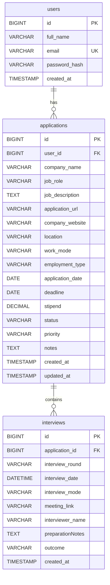

# Internship Application Tracker

[](https://openjdk.org/projects/jdk/21/)
[](https://spring.io/projects/spring-boot)
[](https://www.mysql.com/)
[](https://render.com)
[](https://railway.app)

> A modern, full-stack web application designed for students and graduates to streamline internship applications, monitor real-time statuses, schedule interview rounds, track deadlines, and analyze job search success metrics.

---

## 🚀 Live Cloud Deployment

* **Live Web Application**: [https://internship-application-tracker-6q2w.onrender.com](https://internship-application-tracker-6q2w.onrender.com)
### 🔑 Preloaded Demo Account (Mock Dataset Included)
To explore the live dashboard with preloaded mock applications, interview schedules, metrics, and deadline reminders:
* **Email**: `demo@internshiptracker.com`
* **Password**: `DemoPassword123!`
*(Or click the **"Quick Fill"** button directly on the sign-in page to log in instantly)*
* **GitHub Repository**: [https://github.com/mohammeduzairahmed08-prog/Internship-Application-Tracker](https://github.com/mohammeduzairahmed08-prog/Internship-Application-Tracker)

### 1-Click Deployment to Render
1. Log in to [Render](https://render.com) using your GitHub account (`mohammeduzairahmed08-prog`).
2. Click **New +** ➔ **Web Service** and select `mohammeduzairahmed08-prog/Internship-Application-Tracker`.
3. Choose **Docker** environment (Render automatically picks up [`Dockerfile`](./Dockerfile)).
4. Under **Environment Variables**, set:
   * `SPRING_DATASOURCE_URL` = `jdbc:mysql://<YOUR_DB_HOST>:3306/internship_tracker?createDatabaseIfNotExist=true&useSSL=false&allowPublicKeyRetrieval=true&serverTimezone=UTC`
   * `SPRING_DATASOURCE_USERNAME` = `<YOUR_DB_USER>`
   * `SPRING_DATASOURCE_PASSWORD` = `<YOUR_DB_PASSWORD>`
5. Click **Deploy Web Service**.

---

## 1. Problem Statement

Navigating the internship application process is overwhelming. Students apply to dozens or hundreds of positions across various platforms (LinkedIn, Handshake, company career pages, email referrals). Often, applications slip through the cracks:
- Approaching deadlines are missed.
- Interview video links and interviewer notes get lost in crowded inboxes.
- Students lack clarity on which stages (resume screening, online assessments, interviews) need attention.
- There is no central, organized view of overall progress and conversion rates.

**Internship Application Tracker** solves this problem by providing a centralized, private workspace where each candidate can monitor every stage of their career pipeline from wishlist to final offer.

---

## 2. Project Objectives

- **Centralized Organization**: Consolidate all application metadata (role, description, company URL, work mode, stipend, priority) in one place.
- **Milestone Tracking**: Support multi-stage progression (`Wishlist`, `Applied`, `Online Assessment`, `Interview Scheduled`, `Interview Completed`, `Offer Received`, `Rejected`, `Withdrawn`).
- **Interview Coordination**: Track multiple interview rounds per application with dates, video links, interviewer names, notes, and outcomes.
- **Proactive Alerts**: Deliver automated deadline countdowns and overdue warnings for approaching dates (within 7 days).
- **Data-Driven Insights**: Visualize application velocity, status distribution, and success rates via interactive Chart.js dashboards.
- **Enterprise Security**: Isolate candidate records using BCrypt password hashing and Spring Security session authorization.

---

## 3. Technology Stack

### Backend
- **Java 21 (LTS)**: Core programming language.
- **Spring Boot 3.2.5**: Modern enterprise Java micro-framework.
- **Spring Web**: High-performance RESTful APIs.
- **Spring Data JPA & Hibernate**: Object-relational mapping, custom queries, and dynamic Specification filters.
- **Spring Security 6**: Authentication and session management.
- **Spring Validation**: Jakarta validation constraint enforcement.
- **Maven**: Build and dependency lifecycle management.

### Database
- **MySQL 8.x**: Relational database for production and local development.
- **MySQL Connector/J**: Official JDBC driver.
- **H2 Database (In-Memory)**: Dedicated test database configuration for lightning-fast, isolated automated testing.

### Frontend
- **HTML5 & CSS3**: Modern semantic structure.
- **Bootstrap 5.3.3**: Responsive UI components, grid layout, and accessible modals.
- **Bootstrap Icons 1.11.3**: Clean typography and visual iconography.
- **Chart.js 4.4.2**: Client-side interactive data visualizations (doughnut and line charts).
- **Vanilla JavaScript (ES6+)**: Dynamic asynchronous API communication (`fetch`), state management, and real-time DOM manipulation.

### Development & Testing Tools
- **Visual Studio Code** (with Extension Pack for Java).
- **MySQL Workbench** or MySQL CLI.
- **Postman**: API testing and verification.
- **JUnit 5 & MockMvc**: Integration and unit testing suite.

---

## 4. Architecture

The application adopts a **Clean Layered Architecture** with strict separation of concerns and user data isolation:

```
com.internshiptracker
│
├── InternshipTrackerApplication.java   # Spring Boot bootstrap entry point
│
├── config
│   ├── SecurityConfig.java            # Spring Security 6 session & URL authorization
│   ├── CustomUserDetailsService.java  # User authentication lookup
│   └── UserPrincipal.java             # UserDetails implementation
│
├── controller                         # REST API Controllers (Handles HTTP endpoints)
│   ├── AuthController.java            # User registration, login, logout, me
│   ├── ApplicationController.java     # Full application CRUD, filtering, pagination
│   ├── InterviewController.java       # Interview rounds management
│   └── DashboardController.java       # Analytics, KPI metrics, deadline alerts
│
├── service                            # Business Logic Layer
│   ├── AuthService.java               # Password hashing, session setup, ownership
│   ├── ApplicationService.java        # Application validations, state transitions
│   ├── InterviewService.java          # Interview scheduling & application linking
│   └── DashboardService.java          # KPI aggregation & Chart.js transformations
│
├── repository                         # Data Access Layer (Spring Data JPA)
│   ├── UserRepository.java
│   ├── ApplicationRepository.java
│   ├── ApplicationSpecification.java  # Dynamic multi-predicate query builder
│   └── InterviewRepository.java
│
├── entity                             # JPA Database Entities & Enums
│   ├── User.java
│   ├── Application.java
│   ├── Interview.java
│   ├── ApplicationStatus.java
│   ├── WorkMode.java
│   ├── Priority.java
│   ├── InterviewMode.java
│   └── InterviewOutcome.java
│
├── dto                                # Data Transfer Objects & API Payloads
│   ├── RegisterRequest.java
│   ├── LoginRequest.java
│   ├── UserResponse.java
│   ├── ApplicationRequest.java
│   ├── ApplicationResponse.java
│   ├── ApplicationStatusUpdateRequest.java
│   ├── InterviewRequest.java
│   ├── InterviewResponse.java
│   ├── DashboardSummaryResponse.java
│   ├── StatusDistributionDto.java
│   ├── ApplicationTrendDto.java
│   ├── UpcomingDeadlineDto.java
│   ├── UpcomingInterviewDto.java
│   ├── ApiResponse.java
│   └── ErrorResponse.java
│
└── exception                          # Centralized Error & Exception Handling
    ├── GlobalExceptionHandler.java
    ├── ResourceNotFoundException.java
    ├── BadRequestException.java
    └── UnauthorizedException.java
```

---

## 5. Database Schema

The database `internship_tracker` contains three interconnected tables:



### Cascading Rules & Data Integrity
- Deleting a `User` cascades and deletes all related `applications` and their `interviews`.
- Deleting an `Application` cascades and deletes all scheduled `interviews`.
- Foreign key constraints prevent orphaned records.
- Indexing is established on `email`, `user_id`, `company_name`, `status`, `deadline`, and `interview_date`.

---

## 6. Prerequisites

Ensure the following tools are installed on your Windows machine:

1. **JDK 21** or **JDK 17+**: Verify with `java -version`.
2. **Maven 3.8+** (or use VS Code Java Runner): Verify with `mvn -version`.
3. **MySQL Server 8.x**: Running locally on port `3306`.
4. **Visual Studio Code**:
   - Extension: **Extension Pack for Java** (by Microsoft)
   - Extension: **Spring Boot Extension Pack** (by VMware)

---

## 7. MySQL Setup & Configuration

### Step 1: Create Database & Tables in MySQL Workbench
Open **MySQL Workbench** or your command line MySQL client and execute the provided `database/schema.sql` script:

```bash
# In Windows PowerShell:
Get-Content database/schema.sql | mysql -u root -p
```
Or open `database/schema.sql` in MySQL Workbench and click **Execute (⚡)**.

### Step 2: Configure Environment Variables
You can configure database credentials via environment variables or directly in `src/main/resources/application.properties`.

An example `.env.example` file is included in the project root:
```properties
PORT=8080
SPRING_DATASOURCE_URL=jdbc:mysql://localhost:3306/internship_tracker?createDatabaseIfNotExist=true&useSSL=false&allowPublicKeyRetrieval=true&serverTimezone=UTC
SPRING_DATASOURCE_USERNAME=root
SPRING_DATASOURCE_PASSWORD=YourMySQLPasswordHere
```

In PowerShell:
```powershell
$env:SPRING_DATASOURCE_USERNAME="root"
$env:SPRING_DATASOURCE_PASSWORD="YourMySQLPasswordHere"
```

---

## 8. How to Run the Application

### Option A: Running from Visual Studio Code
1. Open the project folder (`JAVA-DBMS-USE CBP`) in VS Code.
2. Allow VS Code Java Extension to load dependencies from `pom.xml`.
3. Navigate to `src/main/java/com/internshiptracker/InternshipTrackerApplication.java`.
4. Click the **Run** or **Debug** button above the `main` method.

### Option B: Running from Terminal (Command Line)
```powershell
# In PowerShell:
mvn spring-boot:run
```
Or package into an executable JAR:
```powershell
mvn clean package -DskipTests
java -jar target/internship-application-tracker-1.0.0.jar
```

---

## 9. Accessing the Application

Once the backend starts, the frontend is served simultaneously on port `8080`:

| Page | URL | Description |
| :--- | :--- | :--- |
| **Main Dashboard** | `http://localhost:8080/index.html` | Overview, charts, KPI cards, application tracker |
| **Login** | `http://localhost:8080/login.html` | User sign-in with session cookie |
| **Registration** | `http://localhost:8080/register.html` | Create a new student account |

> **Default Landing**: Navigating to `http://localhost:8080/` automatically redirects you to `/index.html` (or to `/login.html` if unauthenticated).

---

## 10. REST API Documentation

### Authentication (`/api/auth`)
| Method | Endpoint | Description | Public / Protected |
| :--- | :--- | :--- | :--- |
| `POST` | `/api/auth/register` | Register a new user account | Public |
| `POST` | `/api/auth/login` | Log in and obtain active session | Public |
| `POST` | `/api/auth/logout` | Invalidate session and clear context | Protected |
| `GET` | `/api/auth/me` | Fetch authenticated user profile | Protected |

### Applications (`/api/applications`)
| Method | Endpoint | Description | Public / Protected |
| :--- | :--- | :--- | :--- |
| `GET` | `/api/applications` | List applications (with search, filter, pagination, sort) | Protected |
| `GET` | `/api/applications/{id}` | Get application details by ID | Protected |
| `POST` | `/api/applications` | Create a new internship application | Protected |
| `PUT` | `/api/applications/{id}` | Update existing application details | Protected |
| `PATCH` | `/api/applications/{id}/status` | Quick status change (e.g. to Offer Received) | Protected |
| `DELETE` | `/api/applications/{id}` | Delete application (cascades to interviews) | Protected |

### Interviews (`/api`)
| Method | Endpoint | Description | Public / Protected |
| :--- | :--- | :--- | :--- |
| `GET` | `/api/applications/{appId}/interviews` | List all interview rounds for an application | Protected |
| `POST` | `/api/applications/{appId}/interviews` | Schedule new interview round | Protected |
| `PUT` | `/api/interviews/{id}` | Update interview round, notes, or outcome | Protected |
| `DELETE` | `/api/interviews/{id}` | Delete interview round | Protected |

### Dashboard Analytics (`/api/dashboard`)
| Method | Endpoint | Description | Public / Protected |
| :--- | :--- | :--- | :--- |
| `GET` | `/api/dashboard/summary` | KPI counts, total apps, offers, success rate | Protected |
| `GET` | `/api/dashboard/status-distribution` | Counts per status for Chart.js doughnut chart | Protected |
| `GET` | `/api/dashboard/application-trends` | 30-day submission velocity for line chart | Protected |
| `GET` | `/api/dashboard/upcoming-deadlines` | Approaching deadlines (7-day window) & overdue | Protected |
| `GET` | `/api/dashboard/upcoming-interviews` | Upcoming scheduled interviews in order | Protected |

---

## 11. Testing

### Automated Backend Tests
The project contains comprehensive unit and integration tests using JUnit 5, MockMvc, and an in-memory H2 database (so tests execute safely without touching your live MySQL database):

Run all tests via terminal:
```powershell
mvn test
```

### Manual Testing with Postman
1. **Register**: Send `POST` to `http://localhost:8080/api/auth/register` with:
   ```json
   {
     "fullName": "Student Developer",
     "email": "student@example.com",
     "password": "Password123!"
   }
   ```
2. **Login**: Send `POST` to `http://localhost:8080/api/auth/login`. Postman will automatically store the `INTERN_SESSION_ID` cookie.
3. **Create Application**: Send `POST` to `http://localhost:8080/api/applications` with:
   ```json
   {
     "companyName": "Google",
     "jobRole": "Software Engineer Intern",
     "workMode": "HYBRID",
     "status": "APPLIED",
     "priority": "HIGH",
     "applicationDate": "2026-10-25",
     "deadline": "2026-11-15",
     "stipend": 8500.00
   }
   ```
4. **Schedule Interview**: Send `POST` to `http://localhost:8080/api/applications/1/interviews` with:
   ```json
   {
     "interviewRound": "Technical Screening",
     "interviewDate": "2026-10-30T14:00:00",
     "interviewMode": "ONLINE",
     "meetingLink": "https://meet.google.com/abc-xyz"
   }
   ```
5. **Get Dashboard**: Send `GET` to `http://localhost:8080/api/dashboard/summary` to verify calculated metrics and success rate.

---

## 12. Future Enhancements

- Resume and cover letter attachment management (file storage / S3 integration).
- Automated email or calendar sync (Google Calendar / Outlook iCal invitations).
- Company rating and salary crowdsourcing benchmarks.
- AI-powered job description analysis and resume keyword optimization tips.

---

## 13. Author

**Internship Application Tracker Project**  
Developed with Java 21, Spring Boot 3, MySQL, and Bootstrap 5.
