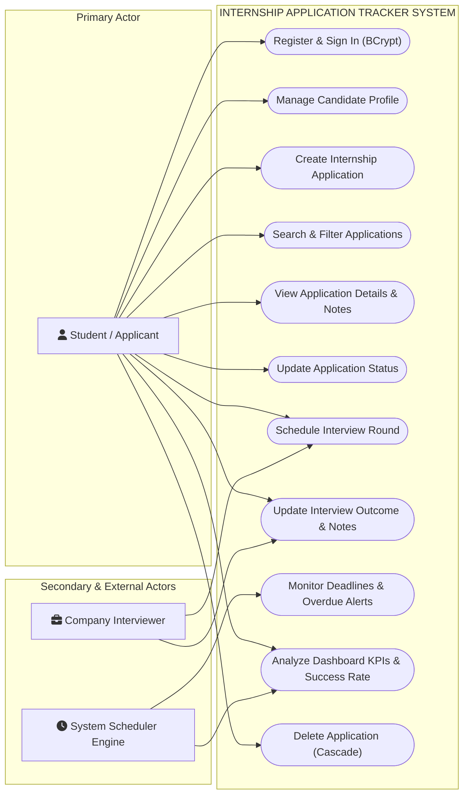
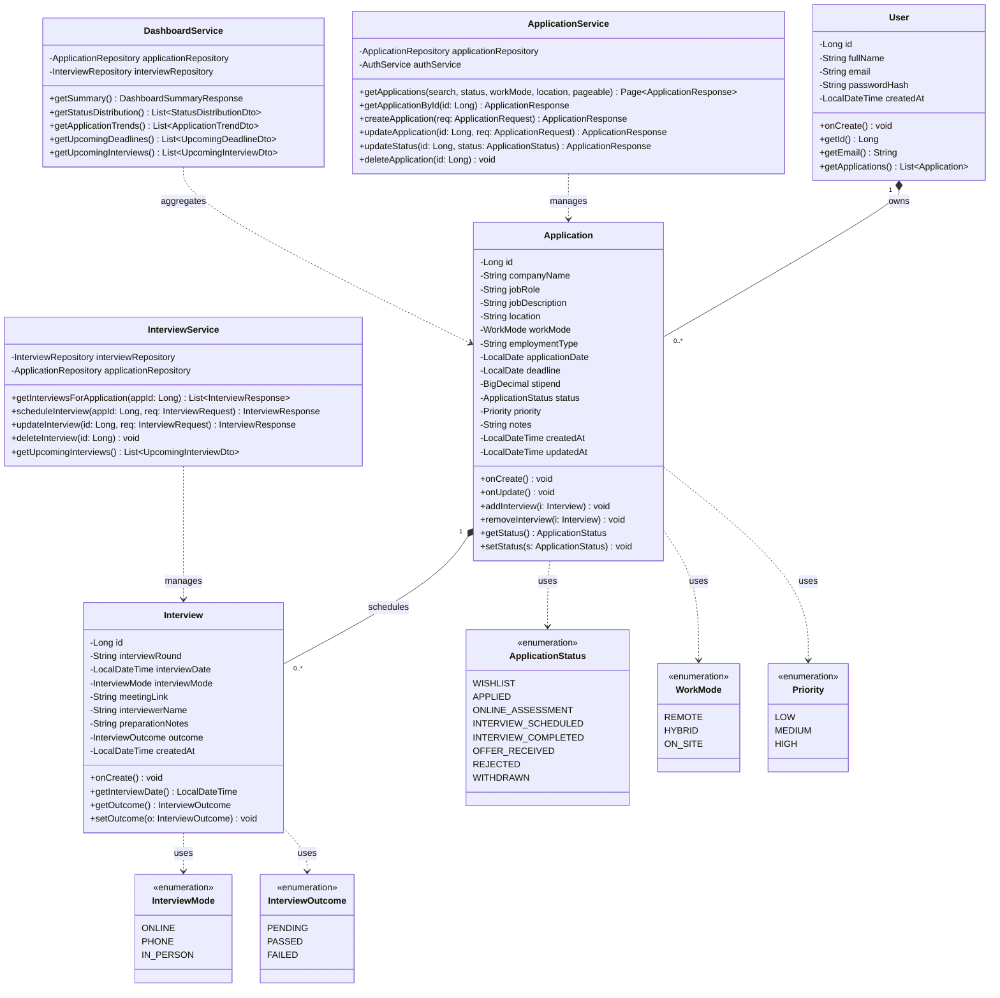
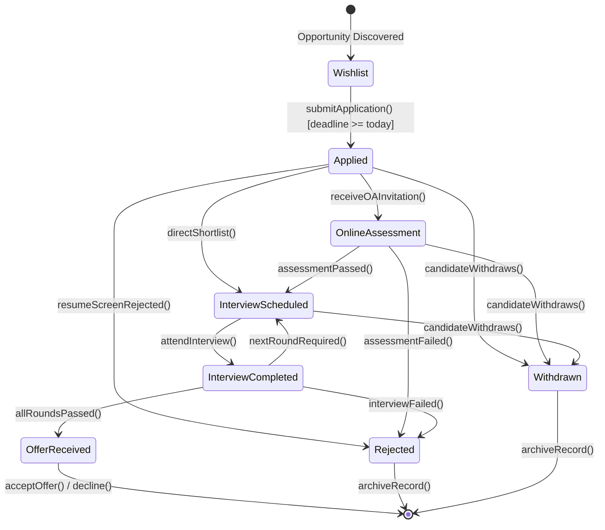
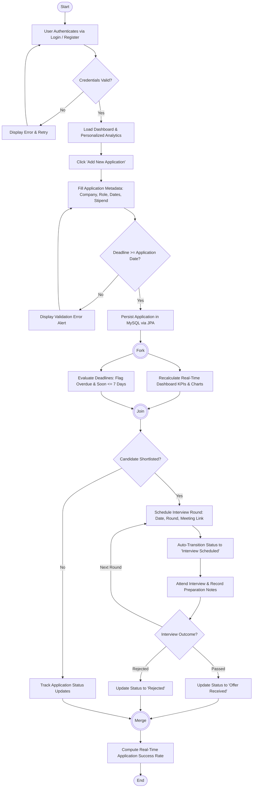
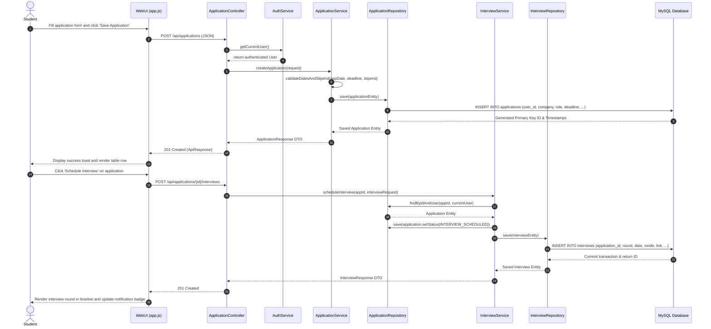

# Internship Application Tracker — UML Diagrams Specification

This document presents the complete architectural and behavioral UML diagrams for the **Internship Application Tracker** full-stack project.

All diagrams are provided in native **StarUML (`.mdj`) format** in this directory, as well as rendered in Markdown with Mermaid syntax for quick visual review, reporting, and documentation.

---

## StarUML File Catalog

| Diagram Type | Native StarUML File Path | Description |
| :--- | :--- | :--- |
| **1. Use Case Diagram** | [`uml/use_case_diagram.mdj`](file:///c:/Users/moham/Downloads/JAVA-DBMS-USE%20CBP/uml/use_case_diagram.mdj) | Candidate, system scheduler, and company interviewer actor interactions. |
| **2. Class Diagram** | [`uml/class_diagram.mdj`](file:///c:/Users/moham/Downloads/JAVA-DBMS-USE%20CBP/uml/class_diagram.mdj) | Domain entities, enums, controllers, services, repositories, and DTOs. |
| **3. State Diagram** | [`uml/state_diagram.mdj`](file:///c:/Users/moham/Downloads/JAVA-DBMS-USE%20CBP/uml/state_diagram.mdj) | Application lifecycle statechart from Wishlist to Offer Received. |
| **4. Activity Diagram** | [`uml/activity_diagram.mdj`](file:///c:/Users/moham/Downloads/JAVA-DBMS-USE%20CBP/uml/activity_diagram.mdj) | Flow of application submission, date validation, and interview scheduling. |
| **5. Sequence Diagram** | [`uml/sequence_diagram.mdj`](file:///c:/Users/moham/Downloads/JAVA-DBMS-USE%20CBP/uml/sequence_diagram.mdj) | Object messaging for application creation and multi-round interviews. |
| **6. Collaboration Diagram** | [`uml/collaboration_diagram.mdj`](file:///c:/Users/moham/Downloads/JAVA-DBMS-USE%20CBP/uml/collaboration_diagram.mdj) | Communication and structural message passing between components. |
| **7. Component Diagram** | [`uml/component_diagram.mdj`](file:///c:/Users/moham/Downloads/JAVA-DBMS-USE%20CBP/uml/component_diagram.mdj) | Client UI, Spring Boot MVC, Security, JPA ORM, and MySQL tiers. |
| **⭐ Master All-in-One** | [`uml/internship_tracker_all_diagrams.mdj`](file:///c:/Users/moham/Downloads/JAVA-DBMS-USE%20CBP/uml/internship_tracker_all_diagrams.mdj) | Consolidated StarUML project holding all 7 models and diagrams. |

---

## 1. Use Case Diagram

### Purpose
Illustrates the interactions between the system actors (**Student / Applicant**, **System Scheduler Engine**, and **Company Interviewer**) and the core functional use cases inside the system boundary.



---

## 2. Class Diagram

### Purpose
Represents the static structure of the system, including Domain Entities, Enumerations, Business Services, Controllers, and Repositories.



---

## 3. State Diagram (State Machine)

### Purpose
Tracks the operational lifecycle states of an `Application` as the student moves through resume screening, assessments, and interview rounds.



---

## 4. Activity Diagram

### Purpose
Depicts the end-to-end workflow of creating an application, validating deadlines, triggering concurrent dashboard KPI updates, scheduling interviews, and evaluating success rates.



---

## 5. Sequence Diagram

### Purpose
Traces the synchronous call sequences and data flows between the Student Actor, Browser Frontend, Spring Boot Controllers, Security Context, Services, Repositories, and the MySQL Database.



---

## 6. Collaboration (Communication) Diagram

### Purpose
Emphasizes the structural relationships between objects and numbers the messages exchanged across communication links.

```mermaid
flowchart LR
    S["1: Student (Actor)"]
    UI["2: WebBrowserUI (Browser/app.js)"]
    AC["3: ApplicationController"]
    AS["4: ApplicationService"]
    Auth["5: AuthService"]
    AR["6: ApplicationRepository"]
    IS["7: InterviewService"]
    IR["8: InterviewRepository"]
    DB[("9: MySQLDatabase")]

    S <-->|1: submitApplication()<br>8: clickScheduleInterview()| UI
    UI <-->|2: POST /api/applications<br>9: POST /api/.../interviews| AC
    AC <-->|3: getCurrentUser()| Auth
    AC <-->|4: createApplication(req)| AS
    AS <-->|5: save(application)| AR
    AR <-->|6: INSERT INTO applications| DB
    AC <-->|10: scheduleInterview(appId, req)| IS
    IS <-->|11: updateStatus(INTERVIEW_SCHEDULED)| AR
    IS <-->|12: save(interview)| IR
    IR <-->|13: INSERT INTO interviews| DB
```

---

## 7. Component Diagram

### Purpose
Exhibits the physical and logical multi-tier architecture, showing software components, provided interfaces, and runtime dependencies.

```mermaid
flowchart TB
    subgraph ClientTier ["PRESENTATION TIER (Browser Client)"]
        UI_SPA["Component: Single Page Application (SPA)"]
        UI_VIEWS["HTML5 / CSS3 Responsive Templates"]
        UI_BOOTSTRAP["Bootstrap 5 UI & Modal Engine"]
        UI_CHART["Chart.js Dynamic Visualizer"]
        UI_FETCH["REST Client Layer (api.js / fetch)"]
        UI_SPA --> UI_VIEWS
        UI_SPA --> UI_BOOTSTRAP
        UI_SPA --> UI_CHART
        UI_SPA --> UI_FETCH
    end

    subgraph WebTier ["API & CONTROLLER TIER (Spring Boot Web)"]
        API_AUTH["AuthController (/api/auth)"]
        API_APP["ApplicationController (/api/applications)"]
        API_INT["InterviewController (/api/.../interviews)"]
        API_DASH["DashboardController (/api/dashboard)"]
    end

    subgraph SecurityTier ["SECURITY COMPONENT (Spring Security 6)"]
        SEC_FILTER["SecurityFilterChain (Session & CSRF Config)"]
        SEC_USERDETAILS["CustomUserDetailsService"]
        SEC_ENCODER["BCryptPasswordEncoder (Strength 12)"]
    end

    subgraph ServiceTier ["BUSINESS SERVICE TIER (Spring Beans)"]
        SVC_AUTH["AuthService"]
        SVC_APP["ApplicationService"]
        SVC_INT["InterviewService"]
        SVC_DASH["DashboardService"]
        SVC_VAL["Jakarta Bean Validation Engine"]
    end

    subgraph DataTier ["PERSISTENCE & DATA ACCESS TIER (Spring Data JPA)"]
        REPO_USER["UserRepository"]
        REPO_APP["ApplicationRepository"]
        REPO_INT["InterviewRepository"]
        SPEC_APP["ApplicationSpecification (Criteria API)"]
        ORM_HIB["Hibernate 6 ORM Engine"]
    end

    subgraph StorageTier ["DATABASE STORAGE TIER (MySQL Server)"]
        DB_DRIVER["MySQL Connector/J 8.3 Driver"]
        DB_SERVER[("MySQL 8.x Database Engine<br>Database: internship_tracker<br>Tables: users, applications, interviews")]
    end

    %% Dependencies and Interfaces
    UI_FETCH -->|HTTP / JSON REST API| WebTier
    WebTier -->|Authenticates Sessions| SecurityTier
    WebTier -->|Invokes Business Logic| ServiceTier
    ServiceTier -->|CRUD & Aggregation Operations| DataTier
    DataTier -->|JDBC Connection Pool (Port 3306)| DB_DRIVER
    DB_DRIVER --> DB_SERVER
```

---

## How to Open and Edit the `.mdj` Files in StarUML

1. **Launch StarUML**: Open StarUML on your Windows computer.
2. **Open Diagram**:
   - Go to **File -> Open...** (or press `Ctrl + O`).
   - Navigate to `c:\Users\moham\Downloads\JAVA-DBMS-USE CBP\uml\`.
   - Select any individual diagram (e.g. `use_case_diagram.mdj`, `class_diagram.mdj`, etc.) or select `internship_tracker_all_diagrams.mdj` to view all 7 diagrams at once in the **Model Explorer**.
3. **Double Click Diagram**: In the right-hand **Model Explorer** panel, expand the model and double-click the diagram name to view and edit on the main design canvas.
4. **Export as PNG / PDF**:
   - Go to **File -> Export Image -> PNG...** or **File -> Export Image -> PDF...** to export high-resolution diagrams for reports and presentations.
